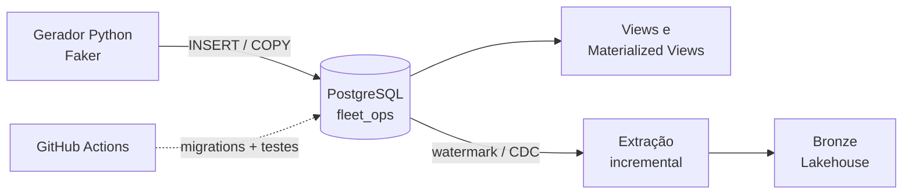

# ⚓ Fleet Ops DB

Banco de dados operacional (OLTP) de uma **frota marítima fictícia**, construído do zero em **PostgreSQL**, com foco em modelagem relacional, integridade, performance, segurança e, no final, extração incremental para um lakehouse.

> 🚧 **Projeto em construção.** Este repositório começa só com o guia e a estrutura. O código é escrito fase por fase. Acompanhe o progresso pelo checklist abaixo e pelas [issues](../../issues).

> ⚠️ Todos os dados são **fictícios e gerados sinteticamente**. Nenhum dado real de empresa é usado.

---

## 🎯 Objetivo

Mostrar, na prática, o lado **transacional** da engenharia de dados: de onde os dados vêm antes de chegar ao lakehouse.

| Tema | O que o projeto demonstra |
|---|---|
| Modelagem | Normalização (3FN), chaves, constraints, tipos corretos |
| Evolução de schema | Migrations versionadas como código |
| Volume | Milhões de linhas sintéticas para testes realistas |
| Performance | Índices, BRIN, particionamento e `EXPLAIN ANALYZE` com antes/depois |
| Lógica no banco | Views, materialized views, funções, triggers e transações |
| Segurança | Roles, privilégios e Row-Level Security |
| DataOps | Docker, testes automatizados e CI no GitHub Actions |
| Integração | Extração incremental e CDC para a camada Bronze de um lakehouse |

## 🧭 Domínio

Uma empresa fictícia de apoio marítimo opera uma frota de embarcações. O banco registra:

- **Embarcações** e seus **equipamentos**
- **Tripulantes** e os períodos em que estão **embarcados**
- **Portos**, **viagens** e **operações**
- **Abastecimentos** de combustível
- **Ordens de manutenção**
- **Leituras de sensores** dos equipamentos (série temporal, alto volume)

A especificação completa das entidades e das regras de negócio está em [docs/MODELO_DE_DADOS.md](docs/MODELO_DE_DADOS.md).

## 🏗️ Arquitetura (visão final)



## 🗺️ Roadmap

Cada fase tem uma issue com o checklist detalhado. O guia completo, com conceitos, entregáveis e critérios de pronto, está em [docs/ROADMAP.md](docs/ROADMAP.md).

- [x] **Fase 0:** Ambiente (Docker + PostgreSQL rodando no Linux Mint)
- [ ] **Fase 1:** Modelagem relacional e diagrama ER
- [ ] **Fase 2:** Migrations versionadas
- [ ] **Fase 3:** Dados sintéticos em volume
- [ ] **Fase 4:** Performance: índices, BRIN, particionamento e `EXPLAIN`
- [ ] **Fase 5:** Lógica no banco: views, funções, triggers e transações
- [ ] **Fase 6:** Segurança: roles e Row-Level Security
- [ ] **Fase 7:** Testes, backup e CI com GitHub Actions
- [ ] **Fase 8:** Extração incremental e CDC para o lakehouse

## 📁 Estrutura

```text
fleet-ops-db/
├── docs/              # Guia, modelo de dados, decisões e resultados
├── migrations/        # Scripts de schema versionados (V001__..., V002__...)
├── seeds/             # Gerador de dados sintéticos (Python)
├── sql/
│   ├── queries/       # Consultas de negócio
│   ├── views/         # Views e materialized views
│   └── functions/     # Funções e triggers PL/pgSQL
├── benchmarks/        # Planos EXPLAIN ANALYZE antes e depois
├── tests/             # Testes automatizados (pytest)
├── extract/           # Extração incremental para o lakehouse (fase 8)
└── .github/workflows/ # CI (você cria na fase 7)
```

Cada pasta tem um `README.md` explicando o que vai nela.

## 🚀 Como começar

1. Prepare o Linux Mint: [docs/SETUP_LINUX_MINT.md](docs/SETUP_LINUX_MINT.md)
2. Siga a **Fase 0** em [docs/ROADMAP.md](docs/ROADMAP.md)
3. Marque o checklist da issue de cada fase conforme avançar


## ▶️ Como rodar

```
1. Copie o arquivo de exemplo e defina sua senha:
   cp .env.example .env
2. Suba o banco:
   docker compose up -d
3. Confira se está saudável:
   docker compose ps
4. Conecte pelo psql:
   psql -h localhost -U fleet_admin -d fleet_ops
5. Para parar o banco (mantendo os dados):
   docker compose down
```


## 🛠️ Stack

PostgreSQL · SQL · PL/pgSQL · Python · Docker · GitHub Actions · pytest

---

Feito por **Arthur Delacorte** · [Portfólio](https://bolapipa.github.io) · [LinkedIn](https://www.linkedin.com/in/arthur-viana-delacorte)
